# family-calendar-kiosk

A wall-mounted calendar and chore board for a family whose children can't all read yet.

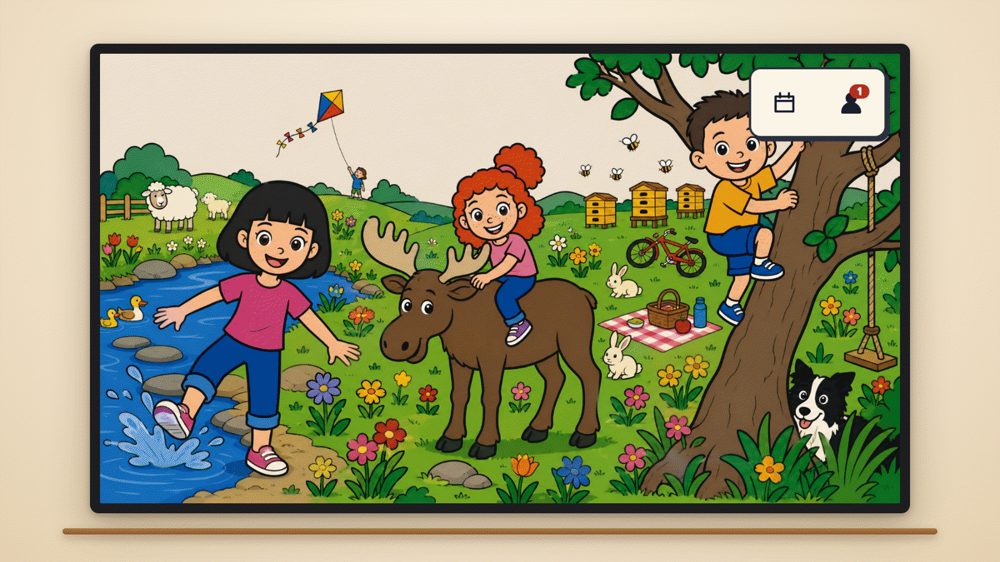

The picture is shaped by your week. Twice a week, on Sunday and Wednesday nights, a text model reads the coming days: the forecast, the holiday, the calendar and any visiting family. It then chooses the setting, the art style and the camera. A birthday party on the calendar can become a party picture, and a book fair a library, without anyone asking. A quiet week gets something fresh from the season's settings. Cousins you describe in `db/guests.json` join the picture while they are in town, described rather than named. By default the model sees only event categories. Set `scenes.shareTitles` to let it read the titles. An all-day event that starts with `scene:` still asks for something outright, such as "scene: ski trip".

## What it does

### A picture that is also the front door


Each week the wall shows a new illustrated scene of your children, and each child finds themselves in it and taps their own figure to open their own screen. The dog is in the picture too: sometimes hiding, sometimes busy with something funny of his own.

### A different picture every week

<table>
  <tr>
    <td>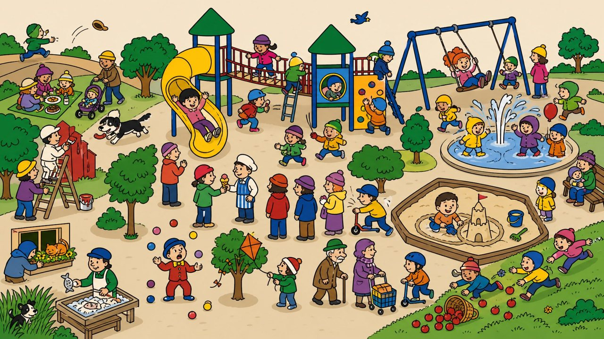</td>
    <td>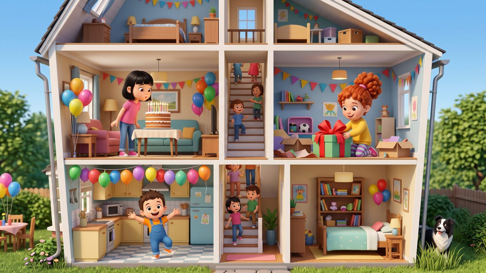</td>
    <td>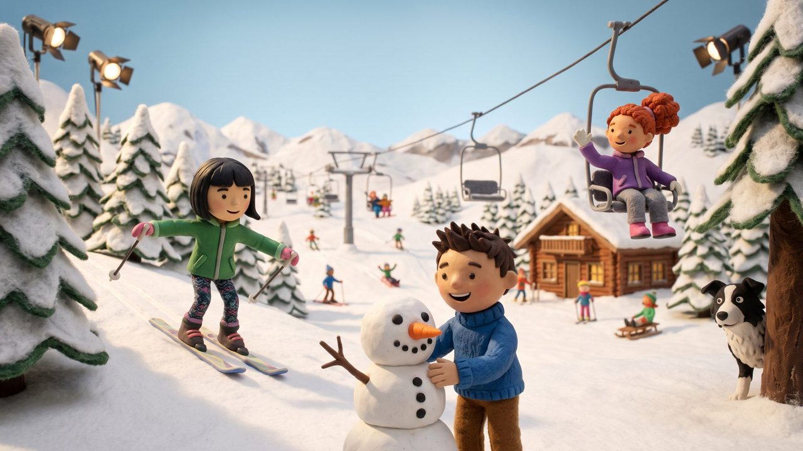</td>
  </tr>
  <tr>
    <td align="center">Seek-and-find · colouring-book cartoon</td>
    <td align="center">Cutaway house · soft 3D</td>
    <td align="center">Claymation</td>
  </tr>
  <tr>
    <td>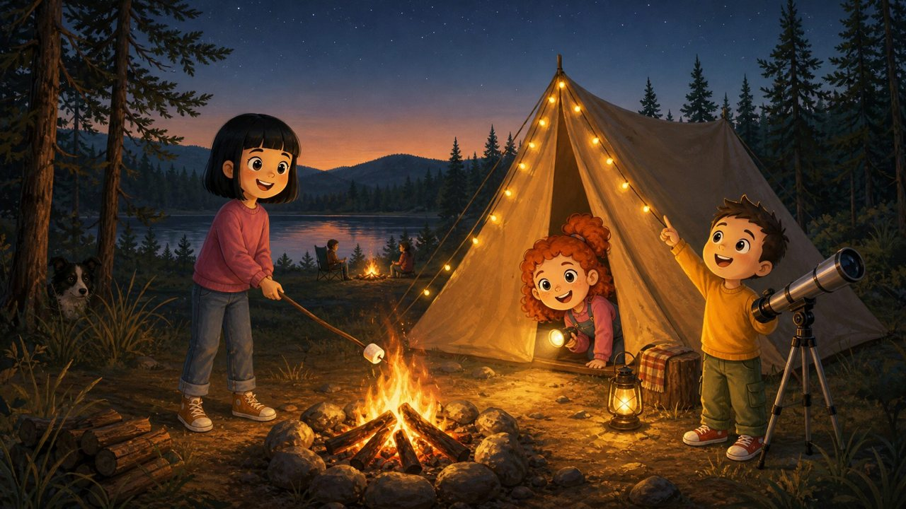</td>
    <td>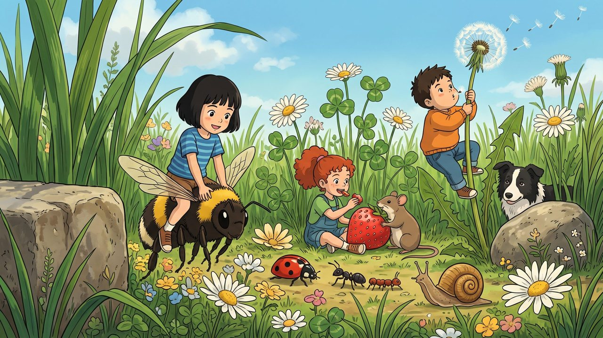</td>
    <td>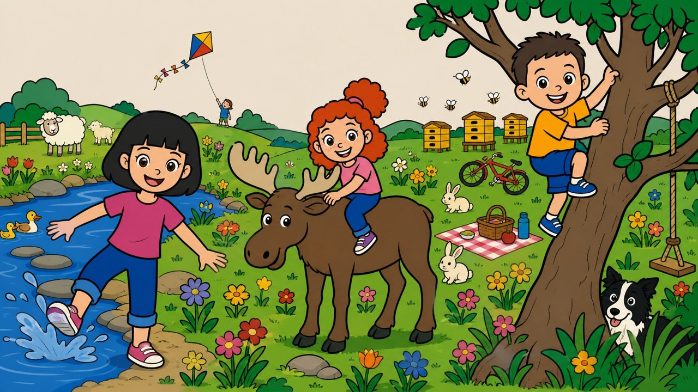</td>
  </tr>
  <tr>
    <td align="center">Warm storybook painting</td>
    <td align="center">Mouse-sized · anime</td>
    <td align="center">The built-in picture</td>
  </tr>
</table>

The setting, the drawing style, the camera and what each child is doing change every week. A few weeks are a special kind of picture: a seek-and-find crowd, a cutaway house, or the children as giants or as mouse-sized. These samples were drawn from the example household's three invented children by `openai/gpt-image-2/edit` and `fal-ai/nano-banana-2/edit` on fal.ai, for $0.05 to $0.12 each. [docs/scenes.md](docs/scenes.md) has the styles, the models and the rules a picture must pass.


Tap the dog and his own sheet opens: the things he is asking the children to do for him today, and the things they saw him do this week.

### The board

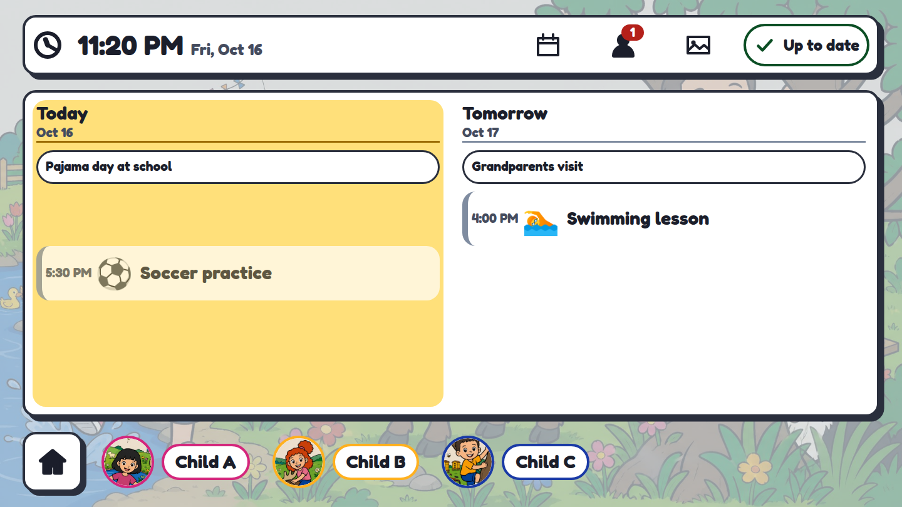

In the morning and evening windows the picture gives way to the board: today, tomorrow, and a face for each child along the rail.

### A screen for every kind of reader

<table>
  <tr>
    <td></td>
    <td>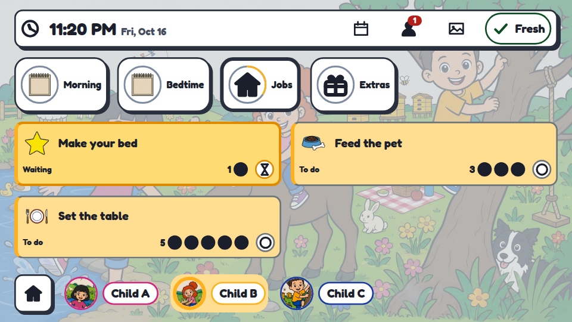</td>
    <td>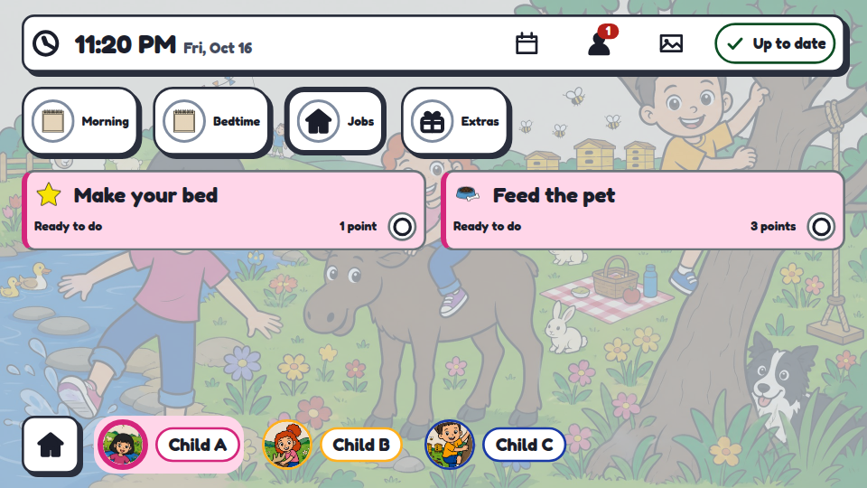</td>
  </tr>
  <tr>
    <td align="center">Pre-reader</td>
    <td align="center">Emergent reader</td>
    <td align="center">Fluent reader</td>
  </tr>
</table>

Every child sees the same routines and chores, drawn for how they read: pictures only, icons and short words, or full text with points and streaks. A grown-up sets the band per child; the wall never guesses it from age.

### The week

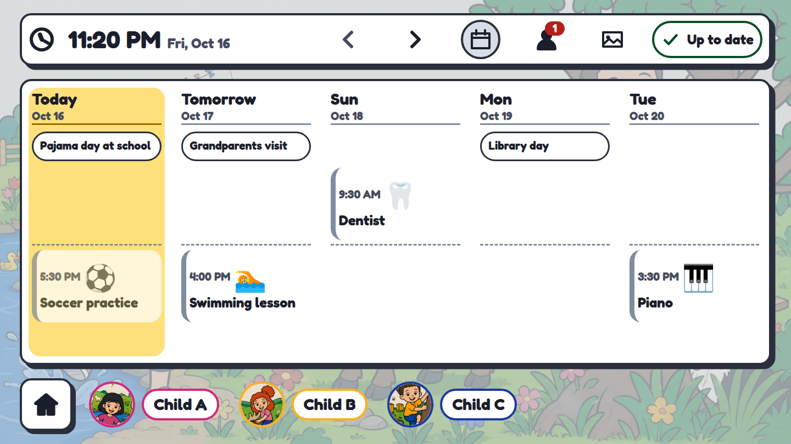

The week ahead, synced from your calendars into the wall's own database so it is there even when the internet is not.

### For the grown-ups

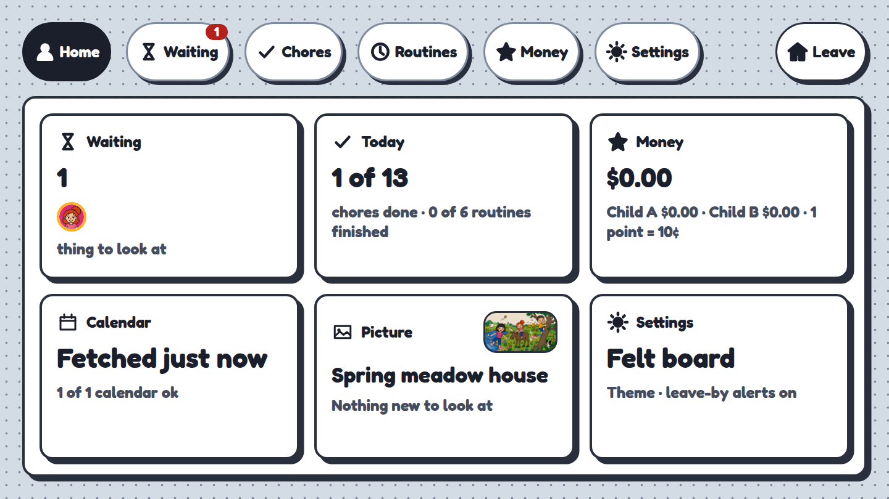 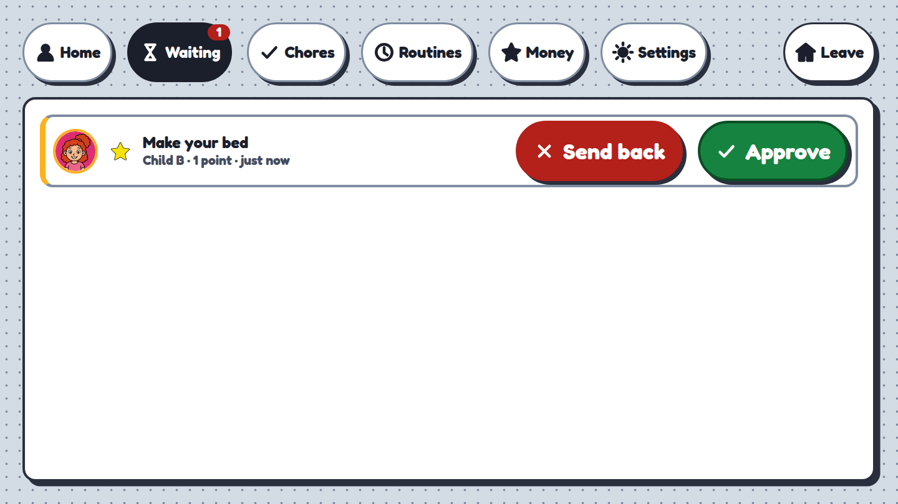

A child claims a chore; a grown-up approves it, and points (or pocket money) land in the ledger. Approvals, money and settings sit behind a PIN, and the wall itself holds no admin session.

### Pictures are chosen by a person


A generated picture is only ever a candidate: each week two are offered, and a person picks one on the panel. Nothing goes up on its own, and approving an older picture again is how you go back.

### It works with no children at all


One child, three children or none: a household without kids gets a calendar and countdown wall over a figure-free backdrop.

## Built for a wall

- **A 1920×1080 touch panel**, designed at 960×540 logical pixels and scaled 2× in the browser.
- **A Raspberry Pi kiosk**: Chromium under labwc on Raspberry Pi OS Lite, reproducible from one script. The Pi is disposable.
- **One container on a home server**: Node 22, Fastify, SQLite and a React panel, all in one process.
- **No cloud on the render path.** Calendars sync into SQLite in the background; the wall reads only its own database and never waits on Google or the network to draw a screen.
- **It keeps showing the last good day when the network drops**, labelled "Showing older information", and the Pi falls back to a live clock over the last-known-good screen rather than a browser error.

## Try it

From the root of your clone:

```bash
npm ci
npm run build                                                  # the server serves web/dist
npm run provision -- --household db/household.example.sql    # three synthetic children
npm run provision -- --settings db/household.example.json     # zone, features, the dog
npm run provision -- --pin 1111                                # the grown-up PIN
npm run provision -- --device "dev browser"                    # prints a device token, once
npm start                                                      # listens on :8124
```

Then open `http://localhost:8124/#dt=<token>`, using the token that `--device` printed.

Full guide: [docs/setup.md](docs/setup.md) · How it works: [docs/architecture.md](docs/architecture.md) · Pictures: [docs/scenes.md](docs/scenes.md) · All docs: [docs/README.md](docs/README.md)

## Contributing

This started as one family's wall, and it gets better with every household that runs it. If you have a kid, a panel, or an opinion about chore charts, you are welcome here. Good first areas:

- **a new scene style** (a drawing, never a photo);
- **a calendar adapter** beside Home Assistant and iCal;
- **a locale** for another language or currency;
- **a reading-band renderer** for another kind of reader;
- **a Pi or panel variant**.

[docs/extension-points.md](docs/extension-points.md) maps the ten places built to be extended. Please read [CONTRIBUTING.md](CONTRIBUTING.md) before your first change, and report vulnerabilities privately as [SECURITY.md](SECURITY.md) describes.

The example household (Child A, Child B, Child C and Biscuit the dog) is synthetic, and every screenshot here is regenerated from it by `npm run screenshots`.

## Privacy

- Calendars, chores, routines and money stay on your server, in one SQLite file; nothing on the wall depends on a cloud service.
- Generated pictures are paid and need your own fal.ai key (about $0.20 a week); use `static` or `off` to skip them. When they run, the providers receive a prompt that names no one (each child's age, hair and relative height, the week's weather and calendar category counts, no event title except one you write as `scene: …`) plus the household's cartoon avatars. Only committed art can be attached, so a photograph cannot be sent.
- The public repo ships synthetic avatars of invented children; your real household files are gitignored.

## License

[AGPL-3.0](LICENSE). Third-party notices are in [THIRD_PARTY.md](THIRD_PARTY.md).
