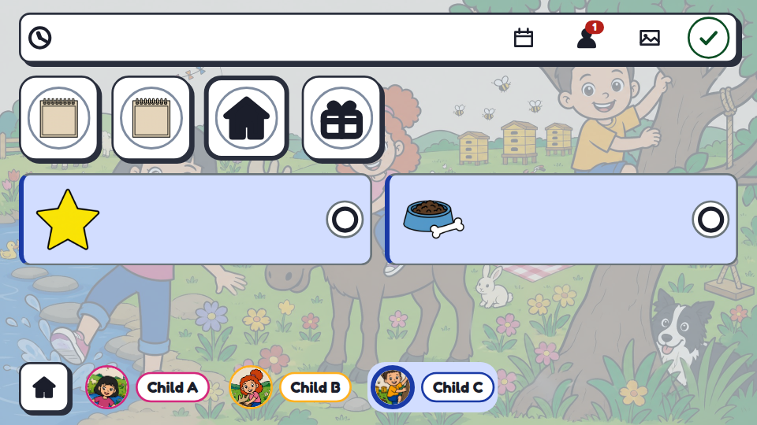
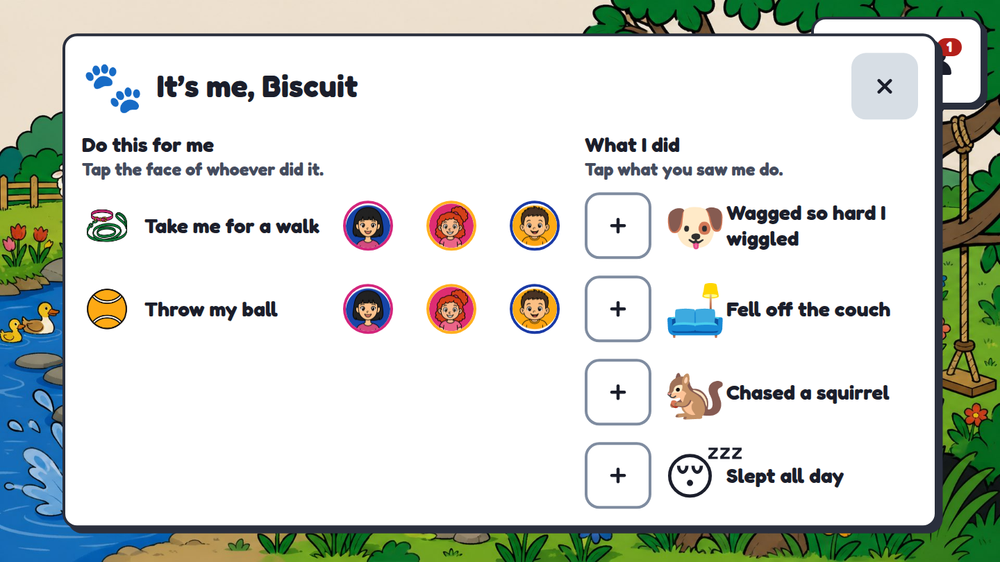
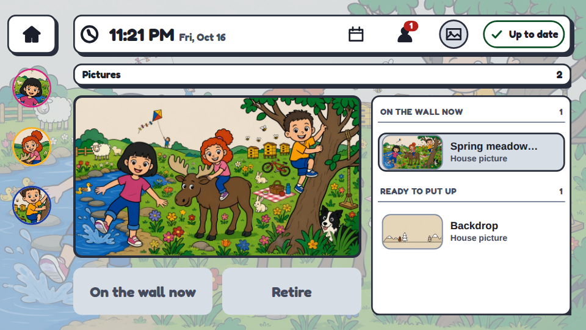

# Pictures (scenes)

This page is the newcomer's guide to the wall's pictures: what a scene is, how one is made,
what it costs, and which rules keep the children recognisable and the household's data at
home. Each number below names the file it comes from. For the design history, see
[scene-pipeline.md](scene-pipeline.md), [scene-imagery-plan.md](scene-imagery-plan.md) and
[scene-prompting-review.md](scene-prompting-review.md).

## 1. What a scene is


A scene is a picture of the household's children, with the dog hidden somewhere in it, plus a
manifest. The manifest holds one tap target per child, a head box for each, and an optional
box for the dog. The picture is the wall's home screen and also its navigation: a child finds
herself in the picture and taps herself to open her own screen. A pre-reader can do that
without reading a word.



Tap the dog and his sheet opens: the pet chores he is asking for, and the things he did this
week.



Each week's picture is shaped by your week. The forecast sets the sky and the coats, a
holiday brings its props, and the calendar's event *categories* scatter things through the
crowd: a ball and cones in a week with a match, ballet slippers in a week with dance. One big
event chooses the whole setting: a birthday party is drawn at a birthday party, a ski trip on a
ski hill, a camping trip at a campsite, a vacation at a station on the morning you set off. The
rules are `tools/scene-headlines.json`; a weekly lesson never counts, and most weeks have no big
event and rotate through the season's settings as usual. An all-day event whose title starts with
`scene:` lets you ask for something outright, such as `scene: ski trip`. Event titles never leave
the house; only a `scene:` note does, because you wrote it to be sent.
[scene-pipeline.md](scene-pipeline.md) §2 has the design.

`scenes.mode` in `household.json` picks one of three modes ([household-config.md](household-config.md)):

- **`off`**: no picture. The wall opens on the board.
- **`static`**: your own picture, free (§6). The Sunday timer does nothing.
- **`generated`** (the default): two new candidate pictures each week (§5).

## 2. The identity rule

A generated picture is useful only if each child can find herself in it. "The same child" is
defined narrowly, as three things: **how many children there are, their height order, and
their hair**. Clothes and faces are allowed to change from week to week, and the prompt says
so. This definition comes from the 2026-09-12 measurements in
[scene-imagery-plan.md](scene-imagery-plan.md) §1. A model that drew a child in a different
jacket had held the cast. A model that drew four children had not.

Identity reaches the model through two channels:

- **Text.** The cast file (`db/cast.json`, gitignored; the synthetic twin is
  `db/cast.example.json`) describes each child's hair and relative height.
  `tools/scene_cast.py` turns it into words.
- **Avatars.** The three committed portraits in `assets/avatars/` are attached to every call.
  When the text and the picture disagree, the model copies the picture. A haircut therefore
  needs a change to the cast file AND to the avatar.

Two more rules:

- **Describe, never name.** A setting from a book is written as what is in it, never as a title,
  character or place name. Named characters are refused far more often than described ones:
  the study cited in [scene-ideas.md](scene-ideas.md) found 91.7 % refusals on GPT Image 2 and
  41.7 % on Nano Banana 2.
- **Child A, Child B, Child C.** Committed files and examples use only the synthetic cast.
  Real names, ages and photographs stay in gitignored files and never enter a prompt as
  committed text.

## 3. Styles

Styles are listed in `tools/scene-styles.json`, in three families:

- **illustration**: house, pencil-spot, dreamlike, cozy-painted, naive-crayon, lantern-night.
- **anime**: anime.
- **render**: soft-3d, claymation, paper-diorama, low-poly.

The `render` family is **a render, never a photo**. A stylised 3D frame is a drawing made with
a different tool, and every render style specifies cartoon proportions, bead eyes, cut paper or
flat facets. A photorealistic style was tried and removed on 2026-09-18. The faces it drew were
almost, but not quite, the children's, which looked worse than a drawing.
`check_tables()` in `tools/scene-week.py` refuses to run, before any spending, if a style or
premise brings the `photoreal` family back.

`scenes.styles` in `household.json` limits the rotation to the styles you list. The rotation
skips any style used by the three most recent pictures.

## 4. Models

Every paid image call goes through `tools/fal_api.py`. Its `MODELS` allowlist is a guardrail:
a model that draws four children produces a picture that looks like a scene and is not one.

| Model | List price / image | Families | Measured |
|---|---|---|---|
| `openai/gpt-image-2/edit` | $0.053 | illustration, anime, render | holds the cast; best height order; cheapest that works; 1920×1072 |
| `fal-ai/nano-banana-2/edit` | $0.12 | illustration, anime, render | holds the cast; once put the eldest at the back |
| `fal-ai/nano-banana-pro/edit` | $0.15 | illustration, anime, render | holds everything |
| `fal-ai/flux-2-pro/edit` | $0.05 | illustration only | holds the cast in cartoon; cannot leave the avatars' style |

Prices and families: `tools/fal_api.py` (`MODELS`, list prices as of 2026-09-12). Verdicts:
[scene-imagery-plan.md](scene-imagery-plan.md) §1. By default the `illustration` family uses
gpt-image-2, and `anime` and `render` use nano-banana-2 (`DEFAULT_FOR_FAMILY` in
`tools/fal_api.py`).

These models were measured and are **not** on the allowlist:

| Model | Why not | Source |
|---|---|---|
| `fal-ai/bytedance/seedream/v4/edit` | drew four children | scene-imagery-plan.md §1 |
| `fal-ai/flux-pro/kontext/max/multi` | drew the wrong children, or two | scene-imagery-plan.md §1 |
| `fal-ai/nano-banana/edit` | held identity but could not leave the avatars' style | scene-imagery-plan.md §1 |
| `fal-ai/gpt-image-1.5/edit` | held identity, 3:2 only; superseded by gpt-image-2 | scene-imagery-plan.md §1 |
| NVIDIA `flux.1-dev` (free) | text-to-image, so it cannot take the avatars. In five scenes it drew four children, two children, three blondes, and three children seen from behind | CLAUDE.md, "Free image generation is not an option" |

Any text-to-image service has the same flaw as the last row: it cannot take the avatars, so it
cannot hold the cast. Three 256-pixel avatars were enough. No model training is needed
([scene-imagery-plan.md](scene-imagery-plan.md) §2).

The **finder** (`tools/scene-regions.py`) is a vision model, `google/gemini-2.5-flash`, called
through `fal-ai/any-llm/vision`. The **activity writer** is a text model at about $0.002 a call
(`tools/fal_api.py`, `VISION_*` and `TEXT_MODELS`).

## 5. Costs, the cap and the ledger

| Item | Cost | Source |
|---|---|---|
| One gpt-image-2 picture | $0.053 | `tools/fal_api.py` |
| One nano-banana-2 picture | $0.12 | `tools/fal_api.py` |
| One nano-banana-pro picture | $0.15 | `tools/fal_api.py` |
| One finder pass | about $0.003 (order of magnitude) | `tools/fal_api.py` `VISION_PRICE` |
| One activity-writer call | about $0.002 | `tools/fal_api.py` `TEXT_MODELS` |
| A weekly pair, including the finder passes | about $0.20 | [scene-prompting-review.md](scene-prompting-review.md) §6 |

A weekly pair is one gpt-image-2 picture and one nano-banana-2 picture, two finder passes on
each, and one writer call: 0.053 + 0.12 + 4 × 0.003 + 0.002 ≈ $0.19.

**The cap.** `scenes.weeklyBudgetUsd` in `household.json` caps spending. It defaults to `null`,
which means no cap, and the example household sets `1.0`. `scene-week.py` checks the cap
before drawing anything, against the ledger's spending over the last seven days plus a
deliberately pessimistic projection. The projection counts each picture twice, because a
re-run after a prompt change buys it again (`budget()` in `tools/scene-week.py`). A dry run of
the example household prints:

```
budget  : spent $0.00 of $1.00 this week, this run $0.360 (pictures $0.346, finder $0.012, writer $0.002)
```

If the run would go over the cap, `scene-week.py` draws nothing and exits with status 3. The
Sunday timer does not retry a 3 or a refusal (1), because a retry would only pay again
(`RestartPreventExitStatus=1 3` in `stacks/wall/systemd/scene-week.service`). It does retry an
error (2), every 30 minutes, at most four times. [runbook.md](runbook.md) §6 lists every exit.

**The ledger.** fal has no balance API and puts no cost in its responses. `tools/fal_api.py`
therefore appends every paid call to `db/fal-ledger.jsonl` (gitignored), with the model, the
list price and the purpose. `python3 tools/fal_api.py` prints the total.

## 6. Candidates, approval and the baseline

A generated picture is a **candidate** and is never put up automatically. Each Sunday at 02:30,
`scene-week.timer` offers two pictures, drawn from the same brief by two models. A grown-up
chooses one on the Pictures screen. **Approving is selecting**: the wall shows the most
recently approved picture, so approving an old one again is how you go back. Approving needs no
PIN. Retiring a picture needs the PIN.



**The baseline.** One drawn picture is committed in `assets/scenes/`, together with a
figure-free `backdrop`. Both are registered on first boot, so a fresh database always has a
picture. The baseline was drawn for three children. It is approved only on a database whose
household has exactly that many active children; otherwise it waits as a candidate.

**A free picture.** To put up your own photo or drawing without any image service:

```bash
npm run provision -- --add-backdrop porch.jpg --id porch    # JPEG or PNG, 4 MB or less
```

The picture goes up at once. It has no tap targets, so the children use the avatars on the
rail to open their screens.

A household with no children gets the `backdrop` the same way, because the baseline does not
fit it:


## 7. Trying it for free

```bash
python3 tools/scene-week.py --dry-run
```

`--dry-run` needs no API key. It prints the week's setting, style, camera, both candidates
and the budget line, then stops with "nothing generated, nothing registered, nothing spent."
Add `--no-context` to skip the week's weather and calendar brief. The style rotation reads the
running wall over `docker exec`. Without Docker, the dry run says so and uses the rotation's
pick.

To generate for real, set `FAL_KEY`. The Sunday timer reads it through `op run` from
`tools/op.env`, which you copy from `tools/op.env.example`.

## 8. The three guardrails

These are code, not instructions to a person or a model:

1. **`tools/prompt_guard.py`** refuses any attachment that is not committed house art inside
   `assets/`. That check is what makes it impossible to send a photograph of a child to an
   image model. It also scans the prompt for roster names and family relationships ("my
   daughter"). Under the default `POLICY = "described"` those matches are only reported, as
   advisories on the receipt, and do not stop the call; `POLICY = "redacted"` refuses them. `npm run verify:prompts` runs its self-test.
2. **`npm run verify:spoilers`** (`tools/scene_story.py --selftest`). A book-themed setting
   shows only moments the children have already read: each moment carries the point in the
   books where a reader meets it, and the household records how far it has read. The
   self-test checks the comparison. It cannot check that a moment is tagged correctly.
3. **The clothed check.** The prompt requires every child fully clothed (`CLOTHED_V2` in
   `tools/gen-scene.py`), and the finder asks the vision model whether each child is fully
   clothed, then refuses the picture if one is not (`tools/scene-regions.py`). Swimwear is a
   per-setting opt-in that still means a covered top and covered bottoms.

## 9. Avatars

The three avatars in `assets/avatars/` are 256×256 JPEGs. They are the strongest identity
channel (§2), and they also appear on the wall's rail. The public tree ships synthetic avatars
of invented children.

To change one detail of an avatar, such as a haircut, edit it in place:

```bash
python3 tools/edit-avatar.py assets/avatars/a.jpg "short brown hair" out.jpg --changing hair
```

`--changing` names what the edit may change. Without it, the prompt asks the model to keep
the hair the same, and a hair edit then fails. The default provider is fal, on gpt-image-2
($0.053), and the call is written to the ledger. After an avatar changes, the next picture is
drawn from the new one. Pictures already approved keep the old look.
